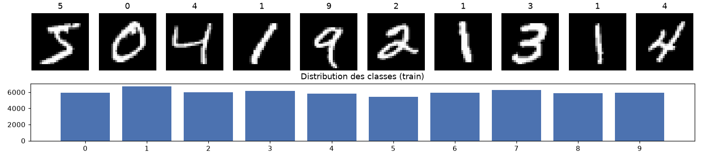
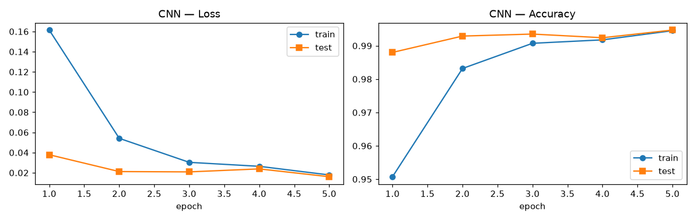
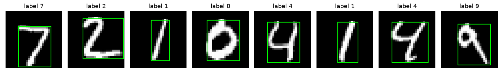
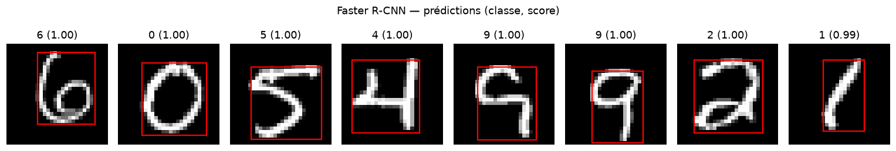
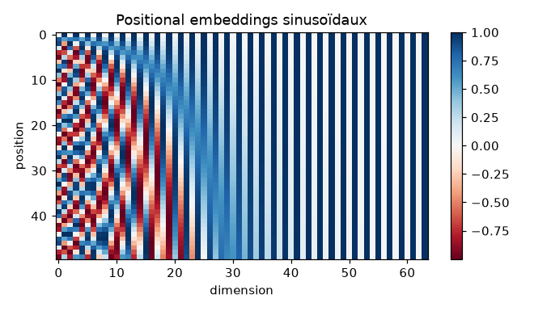
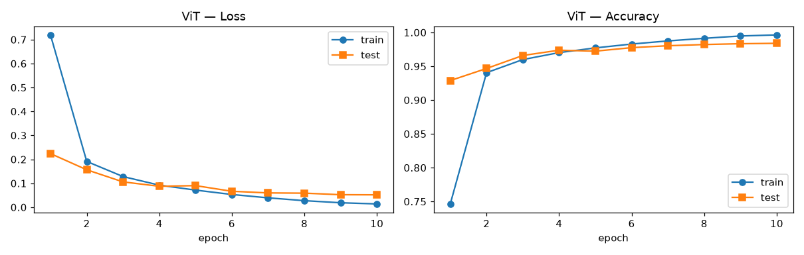
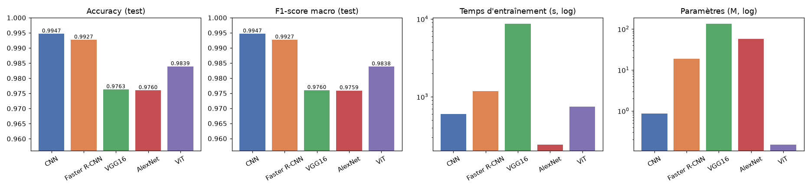
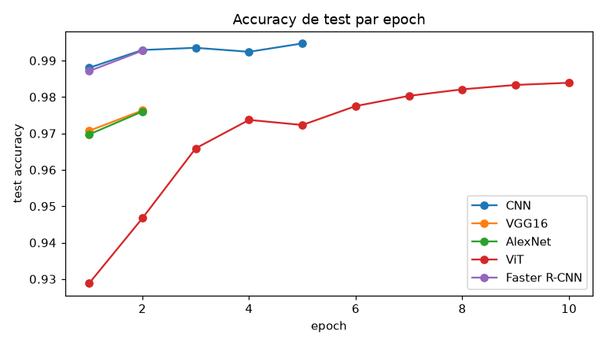

# Lab 2 — Deep Learning avec PyTorch : CNN, Faster R-CNN, VGG16/AlexNet & Vision Transformer

**Université Abdelmalek Essaadi — FST Tanger — Département Génie Informatique — LSI**
**Module :** Deep Learning — **Encadrant :** Pr. ELAACHAK Lotfi

---

## 🎯 Objectif

Se familiariser avec **PyTorch** en construisant plusieurs architectures de vision par ordinateur (CNN, Faster R-CNN, modèles pré-entraînés VGG16 / AlexNet, Vision Transformer), en les entraînant sur **MNIST** (mode GPU si disponible), puis en les comparant avec plusieurs métriques : **Accuracy, F1-score, Loss, temps d'entraînement**.

## 📁 Contenu du dépôt

| Fichier | Description |
|---|---|
| [`Lab2.ipynb`](Lab2.ipynb) | Notebook complet (code + sorties + interprétations) |
| [`results.csv`](results.csv) / [`results.json`](results.json) | Métriques finales de tous les modèles |
| [`figures/`](figures/) | Courbes d'apprentissage, matrices de confusion, comparaisons |
| [`Rapport/Atelier2.pdf`](Rapport/Atelier2.pdf) | Énoncé du TP |

## 📊 Dataset

**MNIST** — [kaggle.com/datasets/hojjatk/mnist-dataset](https://www.kaggle.com/datasets/hojjatk/mnist-dataset), téléchargé automatiquement avec `kagglehub` :

```python
import kagglehub
path = kagglehub.dataset_download('hojjatk/mnist-dataset')
```

Les fichiers au format **IDX** sont lus directement avec NumPy : 60 000 images d'entraînement et 10 000 images de test, en niveaux de gris 28×28, réparties en 10 classes (chiffres 0 à 9). Les images sont normalisées avec la moyenne 0.1307 et l'écart-type 0.3081.



---

## Partie 1 — CNN Classifier

### 1.1 CNN from scratch

| Bloc | Couches | Sortie |
|---|---|---|
| Bloc 1 | Conv 3×3 (1→32, pad 1) + BN + ReLU → Conv 3×3 (32→32) + BN + ReLU → MaxPool 2×2 (stride 2) → Dropout2d 0.1 | 32×14×14 |
| Bloc 2 | Conv 3×3 (32→64) + BN + ReLU → Conv 3×3 (64→64) + BN + ReLU → MaxPool 2×2 → Dropout2d 0.1 | 64×7×7 |
| Classifieur | Flatten → FC 3136→256 + ReLU → Dropout 0.3 → FC 256→10 | 10 |

- **Hyper-paramètres :** kernels 3×3, padding 1, stride 1 pour les convolutions et 2 pour le pooling, batch de 128, 5 epochs.
- **Optimisation :** Adam (lr 1e-3), StepLR (÷2 toutes les 2 epochs), CrossEntropy.
- **Régularisation :** weight decay 1e-4, Dropout et BatchNorm.
- **Taille :** 0.87 M paramètres.



### 1.2 Faster R-CNN

Faster R-CNN est un modèle de **détection**. Pour l'utiliser sur MNIST, on reformule la classification en détection :

- **Cible :** pour chaque image, une boîte englobante calculée à partir des pixels non nuls du chiffre, avec le label `chiffre + 1` (0 est réservé au fond).
- **Modèle :** `fasterrcnn_mobilenet_v3_large_320_fpn` de torchvision, pré-entraîné sur COCO. La tête `FastRCNNPredictor` est remplacée par une tête à **11 classes**, et les images (en 3 canaux) sont redimensionnées en 128×128.
- **Prédiction :** la classe retenue est celle de la détection qui a le meilleur score.
- **Entraînement :** SGD (lr 0.01, momentum 0.9, weight decay 1e-4), warm-up puis décroissance cosinus, 2 epochs sur 10 000 images.

| Boîtes cibles | Prédictions (classe, score) |
|---|---|
|  |  |

### 1.3 Comparaison CNN vs Faster R-CNN

| Modèle | Accuracy | F1 macro | Test loss | Temps d'entraînement | Inférence (10k img) | Paramètres |
|---|---|---|---|---|---|---|
| **CNN** | **99.47 %** | **0.9947** | 0.016 | 598 s (5 ep. × 60k) | **6.5 s** | **0.87 M** |
| Faster R-CNN | 99.27 % | 0.9927 | 0.200* | 1 180 s (2 ep. × 10k) | 146 s | 19.0 M |

\* Pour Faster R-CNN, la loss est la somme des 4 losses de détection (RPN et RoI, classification et régression). Elle n'est pas comparable à la CrossEntropy du CNN.

Le CNN est **plus précis**, environ **30× plus rapide par image** à l'entraînement, **22× plus rapide** en inférence et **22× plus léger**. Faster R-CNN est surdimensionné pour une image qui ne contient qu'un seul chiffre centré. Son seul atout ici est de donner aussi la **localisation** du chiffre.

### 1.4 Fine-tuning de VGG16 et AlexNet

Les deux modèles sont pré-entraînés sur ImageNet. Pour les adapter à MNIST :

- **Prétraitement :** un module `ImageNetAdapter` dé-normalise l'image, la redimensionne en 64×64, la duplique sur 3 canaux, puis applique la normalisation ImageNet.
- **Dernière couche :** `classifier[6]` (4096 → 1000) est remplacée par une couche 4096 → 10.
- **Entraînement :** fine-tuning de **tout le réseau**, avec Adam (lr 1e-4, weight decay 1e-4), pendant 2 epochs sur 10 000 images.

| Modèle | Accuracy | F1 macro | Train loss | Test loss | Temps d'entraînement | Paramètres |
|---|---|---|---|---|---|---|
| **CNN** | **99.47 %** | **0.9947** | 0.018 | **0.016** | 598 s | 0.87 M |
| Faster R-CNN | 99.27 % | 0.9927 | 0.285* | 0.200* | 1 180 s | 19.0 M |
| VGG16 | 97.63 % | 0.9760 | 0.054 | 0.102 | 8 688 s** | 134.3 M |
| AlexNet | 97.60 % | 0.9759 | 0.075 | 0.078 | 240 s | 57.0 M |

\*\* La 2ᵉ epoch de VGG16 a été ralentie par la mise en veille de la machine. L'epoch 1 (839 s, soit environ 84 ms par image) est représentative.

**Conclusion :** les modèles pré-entraînés font **moins bien que le petit CNN** sur MNIST. Plusieurs raisons l'expliquent :

- **Domaine éloigné :** ImageNet contient des photos couleur, alors que MNIST contient des chiffres 28×28 en niveaux de gris, agrandis ici en 64×64.
- **Peu d'entraînement :** seulement 10k images et 2 epochs.
- **Réseaux énormes :** 57 à 134 M de paramètres, qui commencent à sur-apprendre. Pour VGG16, l'accuracy est de 98.5 % en train contre 97.6 % en test, et la test loss vaut le double de la train loss.

Pour un dataset simple et abondant, un **CNN dédié et léger** offre le meilleur compromis entre précision et coût. Le transfer learning est surtout rentable quand les données sont rares et proches du domaine de pré-entraînement.

---

## Partie 2 — Vision Transformer (ViT) from scratch

L'implémentation suit le tutoriel [*Vision Transformers from Scratch (PyTorch): A step-by-step guide*](https://medium.com/mlearning-ai/vision-transformers-from-scratch-pytorch-a-step-by-step-guide-96c3313c2e0c), basé sur l'article de Dosovitskiy et al. (2020). Les étapes sont les suivantes :

1. **Patchify** : l'image 28×28 est découpée en 7×7 = **49 patches** de 4×4.
2. **Linear mapping** : chaque patch (16 valeurs) devient un token de dimension `hidden_d = 64`.
3. **Class token** : un token appris est ajouté en tête, ce qui donne 50 tokens.
4. **Positional embeddings** : un embedding sinusoïdal est ajouté aux tokens.
5. **4 blocs encodeur** : `x + MSA(LN(x))` puis `x + MLP(LN(x))`, avec 4 têtes d'attention et un MLP de ratio 4 (GELU).
6. **Tête de classification** : elle s'applique au class token.

L'entraînement utilise AdamW (lr 1e-3), un scheduler cosinus et 10 epochs sur les 60k images. Le modèle compte **148 k paramètres**.

Améliorations par rapport au tutoriel, sans changer l'architecture :

- `patchify` et l'attention sont **vectorisés**, alors que le tutoriel boucle en Python sur chaque image. L'équivalence avec la version du tutoriel est vérifiée dans le notebook (`torch.allclose → True`).
- La tête renvoie des **logits**. Le tutoriel appliquait un `Softmax` avant `CrossEntropyLoss`, ce qui revient à l'appliquer deux fois.
- Le modèle est un peu plus large (64 / 4 / 4 au lieu de 8 / 2 / 2).

| Positional embeddings | Courbes d'apprentissage |
|---|---|
|  |  |

### Interprétation

- **98.39 % d'accuracy (F1 = 0.9838)** avec le plus petit modèle du lab. Le ViT dépasse VGG16 et AlexNet, mais reste **sous le CNN**.
- **Le modèle n'a pas fini de progresser :** l'accuracy de test augmente encore à chaque epoch (de 92.9 % à 98.4 %). L'écart entre train et test (99.6 % contre 98.4 %) montre aussi un début de sur-apprentissage.
- **Biais inductifs :** le CNN intègre par construction la localité, l'invariance par translation et le partage de poids, qui conviennent bien aux images. Le ViT doit **apprendre** ces relations spatiales grâce à l'attention. Il lui faut donc plus de données ou d'epochs, et c'est pour cela que les ViT dominent surtout lorsqu'ils sont pré-entraînés sur de très grands datasets.
- **Coût :** une epoch de ViT (environ 75 s) est plus rapide qu'une epoch de CNN (environ 120 s), mais il faut 2× plus d'epochs, donc 747 s au total contre 598 s. En inférence, c'est le plus rapide : 4.1 s pour 10 000 images.

---

## 🏁 Comparaison globale



| Rang | Modèle | Accuracy | F1 macro | Temps d'entraînement | Paramètres | Verdict |
|---|---|---|---|---|---|---|
| 1 | **CNN** | **99.47 %** | **0.9947** | 598 s | 0.87 M | meilleur compromis |
| 2 | Faster R-CNN | 99.27 % | 0.9927 | 1 180 s | 19.0 M | précis mais lourd, donne aussi la boîte |
| 3 | ViT | 98.39 % | 0.9838 | 747 s | 0.15 M | très compact, a besoin de plus d'entraînement |
| 4 | VGG16 | 97.63 % | 0.9760 | 8 688 s** | 134.3 M | coûteux, domaine éloigné d'ImageNet |
| 5 | AlexNet | 97.60 % | 0.9759 | 240 s | 57.0 M | rapide mais peu adapté |



> **Conditions d'exécution :** les résultats ci-dessus ont été obtenus **sur CPU**, car la machine n'a pas de GPU NVIDIA. La configuration est donc réduite : Faster R-CNN, VGG16 et AlexNet ont été entraînés sur des sous-ensembles. Le code utilise automatiquement **CUDA et la mixed precision** quand un GPU est disponible (Colab / Kaggle). Sur GPU, on peut utiliser toutes les données en passant `frcnn_train_size=None`, `tl_train_size=None` et `tl_img_size=224` dans la cellule `CFG`.

---

## 🧠 Synthèse — ce que j'ai appris

- **PyTorch :** construire des modèles avec `nn.Module` / `nn.Sequential`, écrire des boucles d'entraînement et d'évaluation génériques, utiliser `Dataset` / `DataLoader`, les optimiseurs (Adam, AdamW, SGD) et les schedulers (StepLR, cosinus, warm-up), et exécuter sur GPU (`.to(device)`, `torch.autocast`).
- **CNN :** le rôle des convolutions, du padding, du stride, du pooling, de la BatchNorm et du Dropout. Un petit CNN bien régularisé suffit pour dépasser 99.4 % sur MNIST.
- **Détection avec Faster R-CNN :** l'architecture backbone + RPN + RoI heads, comment générer des boîtes cibles pour reformuler une classification en détection, et comment remplacer la tête d'un modèle pré-entraîné.
- **Transfer learning :** adapter l'entrée (3 canaux, taille, normalisation ImageNet), remplacer la dernière couche et fine-tuner. Le transfer learning n'est **pas toujours gagnant** quand le domaine cible est très différent.
- **Vision Transformer :** patchify, linear embedding, class token, positional embeddings, Multi-Head Self-Attention, LayerNorm et connexions résiduelles. J'ai aussi compris l'importance des biais inductifs des CNN face aux Transformers.
- **Évaluation :** il faut comparer les modèles sur plusieurs axes (accuracy, F1, loss, temps d'entraînement et d'inférence, nombre de paramètres), et pas seulement sur l'accuracy.

---

## ▶️ Exécution

**En local**
```bash
pip install torch torchvision kagglehub scikit-learn matplotlib pandas
jupyter notebook Lab2.ipynb
```

**Sur Google Colab**
1. *Fichier → Importer le notebook* → `Lab2.ipynb`
2. *Exécution → Modifier le type d'exécution → GPU T4*
3. *Tout exécuter*

**Sur Kaggle**
1. Importer `Lab2.ipynb`.
2. Dans *Settings → Accelerator*, choisir **GPU T4 x2**, puis activer **Internet = On** (nécessaire pour télécharger les poids pré-entraînés).
3. Lancer **Run All**.

> Sur Kaggle, le GPU et l'Internet ne sont disponibles qu'après la **vérification du compte par téléphone**.
